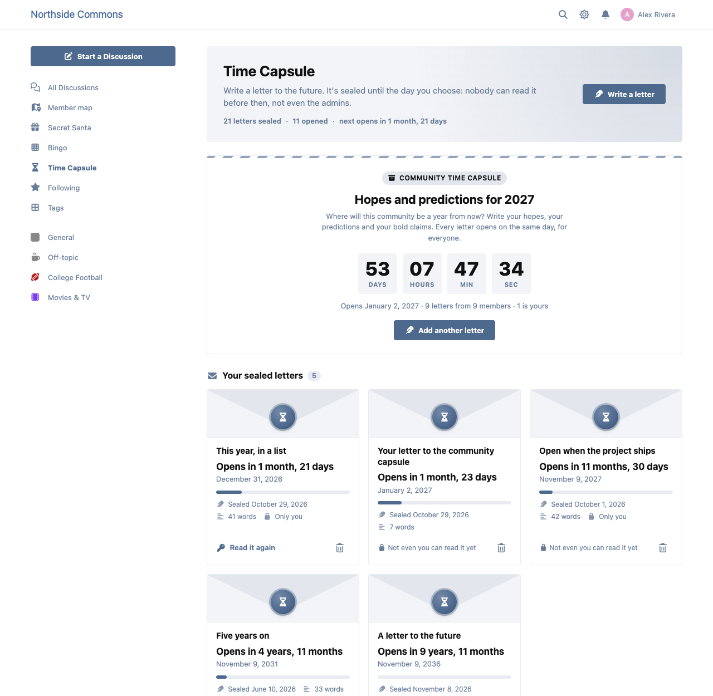
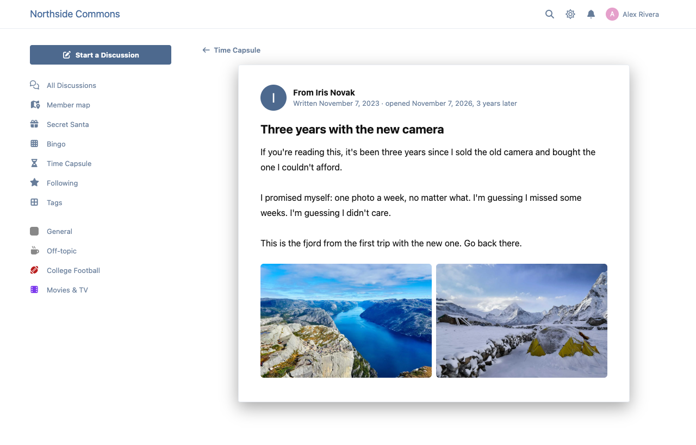
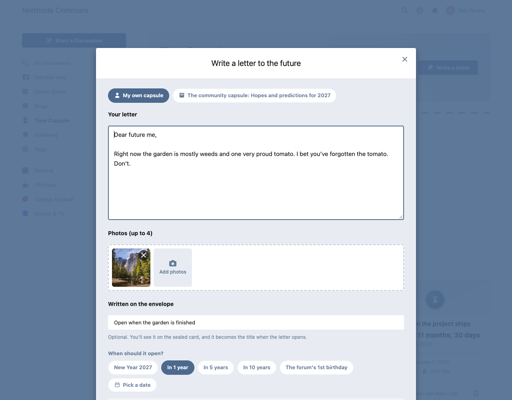

# Time Capsule

Letters to the future, for Flarum 2. Members write a letter, add photos, and pick the day it opens. Until then it's sealed: nobody can read it, not even the admins.

 [](https://packagist.org/packages/ernestdefoe/time-capsule)



- **Write to your future self.** A letter, up to four photos, and an open date: one tap for next New Year, 1, 5 or 10 years, or the forum's next birthday, or any date you like.
- **Really sealed.** Until its day a letter is a card: an envelope with a wax seal, "Opens in 3 years, 2 months", and how far along it is. Its words and photos aren't sent to anyone, the writer included, unless they chose "let me reread it".
- **Encrypted at rest.** Letters and photos are encrypted with a key that is never in the database, so a look at the tables, or a database backup, reads nothing. Photos are kept outside the public folder and their location data is dropped.
- **Opening day.** The scheduler opens letters on the minute their day starts. The writer gets a notification and an email, and the first time they read it the envelope opens. A public letter shows up under "Recently opened", and can start a discussion as its writer.
- **Community capsules.** An admin starts a forum-wide capsule ("Hopes and predictions for 2027"), members add letters, and everything opens on one day for everyone, with a live countdown on the Time Capsule page, a notification for every member and an optional discussion.
- **A home for it all.** /time-capsule has your sealed letters, your opened ones, recently opened public letters, the community countdown and past community capsules.
- **Safe to run.** Opening is idempotent: the scheduler can run every minute, overlap a page load, or crash halfway, and nobody is notified twice or gets two discussions. Forums without a running scheduler still open letters when they're viewed.
- **Permissions** to view, write letters, run the community capsule and delete letters as a moderator.
- **GDPR**: with Flarum's GDPR extension, a member's letters are in their data export (sealed ones as their card) and are deleted on erasure.

| A letter, opened | Writing one |
|---|---|
|  |  |

## Back up the key

Letters are encrypted with the key in `storage/time-capsule/key` (or `'time-capsule' => ['key' => '<base64, 32 bytes>']` in `config.php`). Back up `storage/time-capsule/` with your database: without the key, sealed letters can never be opened.

## Install

```sh
composer require ernestdefoe/time-capsule
```

Flarum's scheduler must be running for letters to open on time ([how](https://docs.flarum.org/2.x/scheduler)).

## Update

```sh
composer update ernestdefoe/time-capsule
php flarum migrate
php flarum cache:clear
```

## Links

- [Packagist](https://packagist.org/packages/ernestdefoe/time-capsule)
- [GitHub](https://github.com/ernestdefoe/time-capsule)
